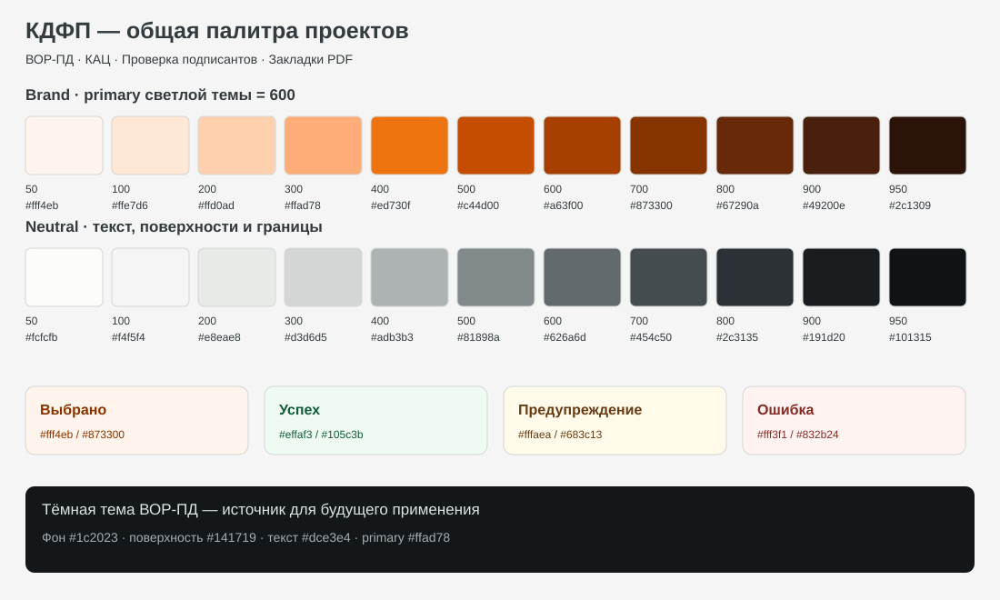

# Рабочее место КДФП — дизайн интерфейсов

## Overview

Статус: **проект для обсуждения**, 17 ноября 2026 года. Это описание целевого интерфейса, а не утверждение, что все экраны уже ему соответствуют. Документ общий для всех проектов; калькулятор будет следующим потребителем этой системы, а не её основой.

Пользователи — инженеры и сотрудники, работающие с документами, трассами и расчётами. Интерфейс спокойный, светлый, читаемый; действия, исходные данные и результат различимы сразу. Плотность умеренная: больше места для рабочих данных, меньше декоративного текста.

Технологии: Vue и Nuxt UI в существующем Vite-портале. Полноценный переход на Nuxt framework не требуется. Наличие Vue-оболочки и косметических CSS-переопределений само по себе не означает завершённую миграцию.

Область применения: все существующие и будущие проекты КДФП, включая отдельные Nuxt-приложения и инструменты Vite-портала.

### На основе чего собрана система

| Источник | Что берём в общую систему | Где проверено |
| --- | --- | --- |
| Проверка ВОР‑ПД | Каноническая палитра, Manrope, светлая/тёмная тема, статусы, доступные поля, панели документов, таблицы проверки | `frontend/app/assets/css/theme.css`, `frontend/app/app.config.ts` в проекте Work with PD and VOR |
| Собрать КАЦ | Двухколоночная загрузка, компактное состояние загруженных файлов, доступность запуска, инструкция | `packages/kac-ui/src/KacAssemble.vue` |
| Проверка подписантов | Результаты и фильтры со счётчиками, пояснения в таблице, страницы/исправление, просмотр PDF | `apps/portal/src/SignaturesCheck.vue` |
| Закладки PDF | Этапы обработки, карточка PDF, параметры, прогресс, результат и скачивание PDF/CSV | `apps/portal/src/BookmarksCheck.vue` |

Это синтез существующих решений, а не новый стиль из внешнего шаблона. Код ВОР‑ПД изучен локально только для чтения; само приложение и его настройки не изменены.

### Зрелость реализации и общие решения

ВОР‑ПД — Nuxt-приложение, портал — Vue/Vite с Nuxt UI. Общими должны быть визуальные правила и компоненты, а не сборщик. КАЦ использует Vue/Nuxt UI; закладки используют реактивное состояние Vue; подписанты пока частично используют DOM-контроллер. Этот технический долг не считать рекомендуемым шаблоном.

Тёмная тема уже описана в ВОР‑ПД, но в портале ещё не включена. Ниже она зафиксирована как доступный источник для будущих проектов; текущие экраны портала не объявляются поддерживающими её.

## Colors

Числа в YAML взяты из `packages/tokens/tokens.css`. Этот CSS — канонический источник значений; при расхождении сверять с ним и согласованными решениями. В компонентах применять семантические токены Nuxt UI (`primary`, `text-muted`, `border-default`), не добавлять новые локальные оттенки коричневого.

- Коричневый `primary` — основное действие, выбранная вкладка, фокус и активный чекбокс.
- Белая поверхность на светлом сером фоне — карточки и рабочие панели.
- Основной и приглушённый текст — читаемые серые оттенки; вторичный текст не делать полупрозрачным.
- Успех, предупреждение и ошибка — семантические `success`, `warning`, `error` из текущей темы Nuxt UI. Статус всегда имеет текст, а не только цвет.
- Яркий оранжевый не использовать для кнопок, hover, фокуса, чекбоксов и вкладок. Оранжевый в фирменном логотипе сохраняется.
- Красный PDF, синий Word и жёлтая папка допустимы как цветовые обозначения типов файлов. Обычные ссылки и действия не делать синими.
- Читаемость: контраст текста не ниже 4.5:1; крупного текста и значимых границ элементов — не ниже 3:1. Проверять фактические пары, включая disabled и hover.

### Семантические цвета, подтверждённые в ВОР‑ПД

| Роль | Светлый фон / текст | Тёмный фон / текст | Применение |
| --- | --- | --- | --- |
| Выбранное | `#fff4eb` / `#873300` | `#39271e` / `#ffd0ad` | Навигация, выбранный объект |
| Успех | `#effaf3` / `#105c3b` | `#142f23` / `#a2e8bf` | Обработка завершена, подтверждённый результат |
| Предупреждение | `#fffaea` / `#683c13` | `#352c19` / `#f6d695` | Нужна проверка, неполные данные |
| Ошибка | `#fff3f1` / `#832b24` | `#392322` / `#ffc6bd` | Ошибка обработки, блокирующая проблема |

Тёмные базовые роли ВОР‑ПД: поверхность `#141719`, фон `#1c2023`, поднятая поверхность `#252a2e`, основной текст `#dce3e4`, приглушённый `#a3adb0`, граница `#434c50`, primary `#ffad78`. Не инвертировать цвета файлов и логотипа автоматически.

Палитра brand содержит и более яркие ступени, поскольку они нужны для полной шкалы и наследуются из ВОР‑ПД. Их наличие не разрешает использовать ярко-оранжевый как основной цвет действий в светлой теме.

## Typography

Основной шрифт — локальный Manrope, запасные `ui-sans-serif, system-ui, sans-serif`. Не подключать внешние шрифты для работы портала.

Заголовок страницы 36px, на узких экранах 28–30px. Панели 20–22px; обычный текст 16px, рабочие таблицы и элементы управления 14px, пояснения 13px. В инженерной панели допустима более плотная подача без уменьшения текста до нечитаемого размера.

Подписи всегда связаны со своим полем. Единицы измерения видимы рядом с числом или в заголовке колонки. Для числовых колонок использовать табличные цифры и выравнивание вправо. Названия и описания переносить, не обрезать важные данные без возможности прочитать полностью.

## Layout

Обычный экран инструмента: заголовок и короткое пояснение → параметры/загрузка → результат. Рабочая ширина до 1440px, боковые поля 32px на десктопе и 16px на телефоне. Боковое меню портала занимает всю высоту; внутри инструмента его не дублировать.

Отступы кратны 4px. Между карточками 24px, внутри 24px, между полем и подписью 6–8px, между связанными действиями 8–12px. Форма не должна сливаться в одну строку.

Этапы процесса распределять равномерно по ширине. На узком экране — вертикальный список. Показатель этапов и одно сообщение о текущей операции достаточны: не повторять один статус в двух больших блоках.

### Шаблоны экранов для всех проектов

| Шаблон | Состав | Примеры |
| --- | --- | --- |
| Загрузка и обработка | Шапка → загрузка/параметры → один прогресс → результат и выгрузка | КАЦ, закладки |
| Проверка документов | Входные документы слева → фильтры и таблица справа → просмотр источника | Подписанты, ВОР‑ПД |
| Работа с документом | Список/структура → PDF → связанные замечания и действия | ВОР‑ПД, просмотр источника подписи |
| Редактор проекта | Список проектов → рабочая область → параметры → ведомость | Будущий перенос калькулятора |

У всех шаблонов общие палитра, типографика, поля, кнопки, статусы и правила ошибок. Декор и плотность зависят от задачи: иллюстрация допустима в пустом экране загрузки, но не занимает место рабочей сцены или PDF.

### Предлагаемая компоновка калькулятора

Калькулятор — рабочий редактор; для него допустимо занять всю доступную ширину вместо ограничения 1440px.

1. Список проектов и схем: заголовок, поиск/фильтры, основное действие создания, карточки или таблица существующих записей. Архив и корзина — отдельные вкладки.
2. Открытая схема: компактная шапка с названием, навигацией и статусом сохранения. Ниже панель инструментов с явным выбранным режимом.
3. Рабочая область: дерево объектов слева, сцена и результаты по центру, параметры выбранного объекта справа. Предлагаемые ширины: дерево 240–280px, параметры 320–380px, центр занимает остаток. Конкретные размеры проверить на реальном экране.
4. Узкий экран: дерево и параметры открываются через `USlideover`; сцена остаётся доступна. Не сжимать три колонки до нечитаемого состояния.
5. Итоги и ведомость: единицы измерения, разделение траншей/котлованов, связь строки с объектом. Выбор объекта синхронен в дереве, сцене и параметрах.

Это предложение для визуального макета; изменение компоновки не разрешает менять модель данных или расчёт.

## Elevation & Depth

Плоский интерфейс. Иерархия через фон, границу и отступы. Кнопки не выглядят объёмными; постоянных теней и градиентов нет. Небольшая тень допустима у модального окна или выпадающего меню.

## Shapes

Поля 6px, кнопки 8px, панели 12px. Не использовать чрезмерно круглые капсулы для обычных действий. Фокус — видимая коричневая обводка с отступом; требование убрать рамку основной кнопки не означает убирать клавиатурный фокус.

## Components

| Назначение | Компонент Nuxt UI | Правило |
| --- | --- | --- |
| Основное действие | `UButton`, primary, solid | Белый текст, коричневый фон, без постоянной рамки/тени |
| Дополнительное действие | `UButton`, neutral, outline | Читаемый текст, тонкая граница, высота около 40px |
| Ссылка скачивания | `UButton`, `to`, `external`, `download` | Проверять реальное скачивание PDF/CSV; компактная высота, не растягивать на всю карточку |
| Удаление файла/закрытие | `UButton`, icon/ghost | Заметный крестик, понятный `aria-label`, зона нажатия минимум 36px |
| Поле и подпись | `UFormField` + `UInput` / `UInputNumber` | `v-model`, единицы, ограничения и ошибка рядом |
| Выбор | `USelect` / `USelectMenu` | Предсказуемые значения, сохранённый выбор |
| Галочка | `UCheckbox` | Коричневый checked, видимая белая галочка, без оранжевой вспышки |
| Вкладки | `UTabs` | Плоские, активная с коричневой нижней линией, счётчики рядом с названием |
| Таблица | `UTable` | Заголовки, разделители строк, читаемые переносы, явные действия |
| Статус | `UBadge`, `UAlert` | Семантический цвет, текст, при необходимости иконка |
| Диалог | `UModal` | По центру viewport, ограниченная высота, прокрутка содержимого |
| Боковые параметры | `USlideover` | Сохранение выбора и доступная кнопка закрытия |
| Справка и вторичные параметры | `UCollapsible` | Краткая подпись, без сокрытия важных результатов |
| Прогресс | `UProgress` / индикатор + текст | Не показывать выдуманный процент без данных |

Фактические API компонентов сверять с установленной версией `@nuxt/ui` и существующими примерами в проекте. Таблица или SVG могут остаться нативными, если это требуется для точного поведения; такое решение описать явно.

### Состояния и поведение

- Каждый контрол поддерживает default, hover, focus-visible, disabled и при необходимости loading/error.
- Состояние Vue — источник значений и доступности кнопок. Не переключать `disabled`, текст или классы Nuxt UI вручную через DOM.
- До выбора файла запуск недоступен; после выбора — доступен; «Проверить заново» появляется после завершённой проверки.
- PDF-карточка: красный лист с загнутым углом и PDF, название, отдельная заметная кнопка удаления. Без лишнего веса файла в уже согласованных экранах.
- В таблице имя, страницы, пояснения и результат визуально разделены. Пояснения подписей видны сразу. Страницы и «Исправить» выглядят интерактивными.
- Информационные ограничения оформлять `UAlert`, а не слипшимся текстом рядом с полем.
- Escape, закрытие и фокус в диалоге должны работать; после закрытия возвращать фокус к вызвавшему действию. Загрузка и смена вкладки не должны терять незавершённую работу.
- Декоративный рисунок закладок сохранять; у калькулятора не добавлять декор поверх рабочей сцены.

### Калькулятор: граница визуального переноса

Сохранить модели и формулы из `apps/trench/dist/network-model.js`, поведение связанных видов, геометрию, значения по умолчанию, округление, единицы, правила валидации и блокировки итогов. Сохранить API, SQLite, версии записей, автосохранение, импорт/экспорт JSON, undo/redo, архив/корзину/восстановление и подтверждения удаления.

План, профиль, 3D и сечения — специализированная графика, а не обязательная замена на компонент Nuxt UI. Сохранить масштаб, выбор, перетаскивание, связь видов и подсветку объектов. Переносить управление в Vue постепенно, не менять формулы ради упрощения компонента.

Не скрывать предупреждение или отключённый итог только ради чистого макета. В интерфейсе всегда видно, расчёт предварительный или заблокирован и почему.

## Do's and Don'ts

**Делать:** использовать общие токены; проверять читаемость и реальные клики; сохранять API и данные; тестировать кнопки скачивания; различать результат и предупреждение; согласовывать новые визуальные решения по документу.

**Не делать:** ярко-оранжевые или синие обычные действия; объёмные вкладки; растянутые по высоте кнопки; непрозрачные DOM-адаптеры с одинаковыми ID; дубли статусов; пустые текстовые символы вместо читаемых иконок; автоматический перенос всех CSS-правил старого приложения в портал.

### Проверка перед признанием переноса завершённым

- Чистая сборка и соответствующие тесты модели/сервера проходят.
- До и после переноса на одной копии схемы совпадают исходные данные, объёмы, материалы, предупреждения и блокировки. Допуски сравнения не менять ради прохождения проверки.
- Пройдены создание/открытие проекта и схемы, выбор и редактирование объекта, связанные виды, undo/redo, сохранение и повторное открытие, JSON, ведомость, архив/восстановление.
- Проверены мышь, клавиатура, focus, центрирование окон, узкий экран, длинные названия и ошибки сети/конфликт версии.
- Пользовательские проекты для проверки не менять без необходимости: использовать тестовые копии и сохранять исходники.
- Результаты проверки записаны честно: модульный тест или успешная сборка не заменяют проверку сценария в браузере.
- Перед переносом есть точка отката; откат UI не удаляет БД, проекты или загруженные файлы. Изменение схемы хранения — отдельная задача.

### Решения для согласования общей системы

- Размеры: ВОР‑ПД задаёт кнопкам и полям минимум 44px, в трёх вкладках портала используются компактные кнопки около 40px. Предложение: 44px для основных форм и сенсорного ввода, 40px для рабочих панелей, 36px только для вспомогательных иконок с понятной зоной нажатия.
- Фокус: ВОР‑ПД использует мягкое коричневое свечение полей, портал — контур. Общая цель: заметный коричневый фокус без оранжевой вспышки; точное оформление выбрать на общем примере, затем унифицировать.
- Тёмная тема: сохраняем спецификацию ВОР‑ПД, но не включаем её в других проектах до проверки контраста, PDF и графики.
- Калькулятор: отдельно проверить три колонки, плотность параметров и первичный список проектов. Это применение общей системы, не новая независимая палитра.

### Источники и сопровождение

- Структура документа адаптирована из [DESIGN.md specification](https://github.com/google-labs-code/design.md/blob/main/docs/spec.md): токены и объяснение правил. Соответствие машинной схеме отдельным линтером пока не проверялось.
- Общие значения портала: `packages/tokens/tokens.css`, подключение — `apps/portal/src/assets/main.css`.
- Исходная тема ВОР‑ПД: `../Work with PD and VOR/frontend/app/assets/css/theme.css`; компоненты и размеры — `../Work with PD and VOR/frontend/app/app.config.ts`. Пути здесь локальные ссылки на изученный источник, не новая зависимость сборки.
- Наглядная палитра: `docs/design/palette.svg`. Значения должны совпадать с таблицами документа и исходной темой.
- Текущие компоненты: `packages/kac-ui/src/KacAssemble.vue`, `apps/portal/src/BookmarksCheck.vue`, `apps/portal/src/SignaturesCheck.vue`.
- Поведение калькулятора и ограничения: `apps/trench/README.md` и `apps/trench/NETWORK.md`.

После согласования менять этот документ вместе с общими токенами и компонентами. При новом инструменте переиспользовать правила, а различия описывать в отдельном разделе без копирования всей системы.
